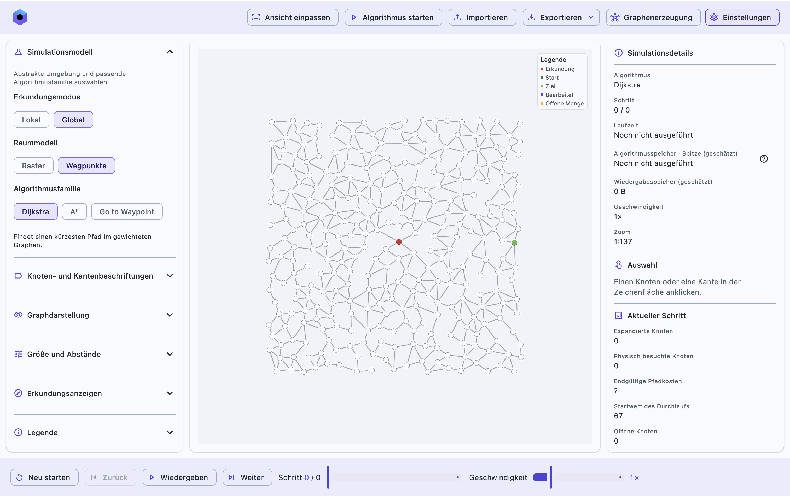
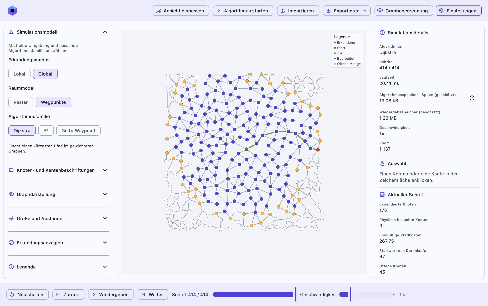
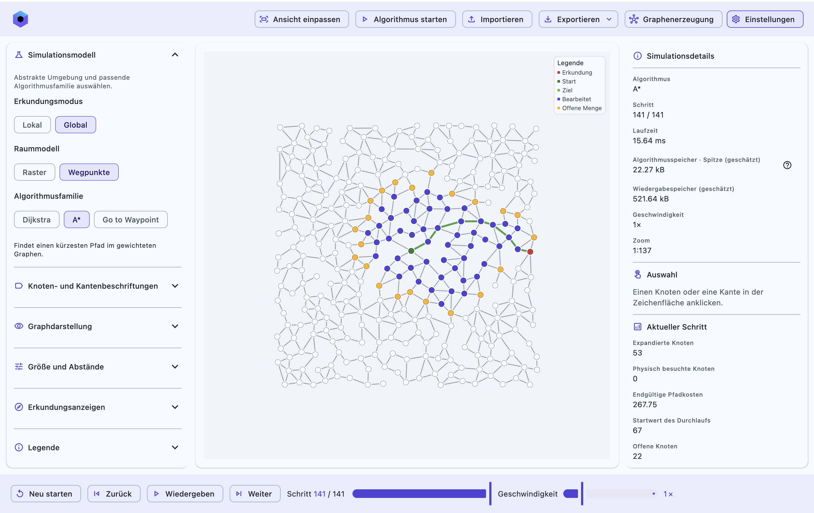

# WSMarsRoverSim

Eine interaktive Simulation zur Pfadplanung eines Marsrovers, entstanden im Rahmen
der W-Seminararbeit. Simuliert wird die schrittweise Suche von Dijkstra und A* auf gewichteten
Graphen in einer interaktiven und visuell anpassbaren Umgebung.

[Im Browser öffnen](https://purerevan.github.io/WSMarsRoverSim/) ·
[Desktop-Version herunterladen](https://github.com/PureRevan/WSMarsRoverSim/releases/latest)

## Dijkstra und A* im Vergleich

Neben Wegpunktgraphen lassen sich auch Raster erzeugen. Mit „Go to Waypoint“ können
einzelne Ziele manuell vom Nutzer vorgegeben werden. Das linke Menü erlaubt das Vornehmen einer Vielzahl von visuellen Änderungen, im rechten Menü werden verschiedenste Informationen, etwa über angeklickte Knoten oder Kanten, dargestellt.

Graphen, Einstellungen und aufgezeichnete Abläufe lassen sich als Dateien speichern und
wieder laden. Einzelne Ansichten können als PNG, SVG oder PDF exportiert werden (auf die gewählte Auflösung und die daraus resultierende eventuell sehr große Dateigröße sollte geachtet werden).
Die Anwendung basiert auf Kotlin Multiplatform und Compose. Hinweise zum Bauen
und Veröffentlichen stehen in [PUBLISHING.md](docs/PUBLISHING.md).

[Lizenz (MIT)](LICENSE) · [Bibliothekslizenzen](licenses/)
